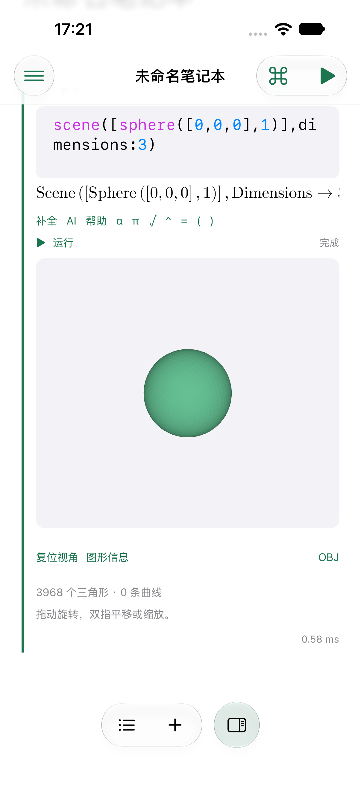
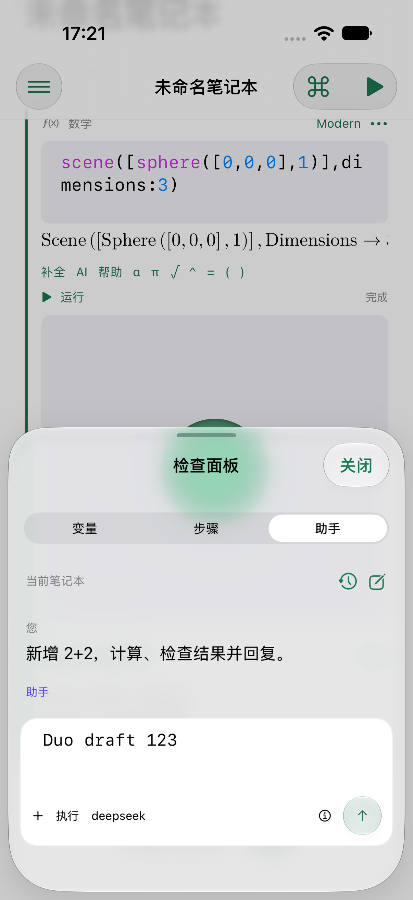
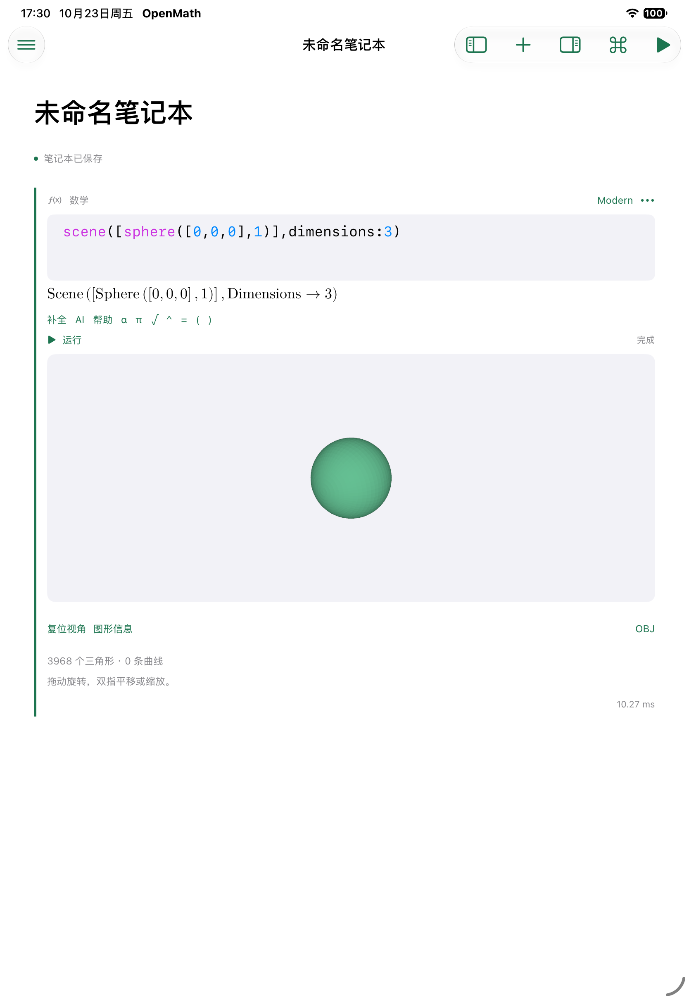
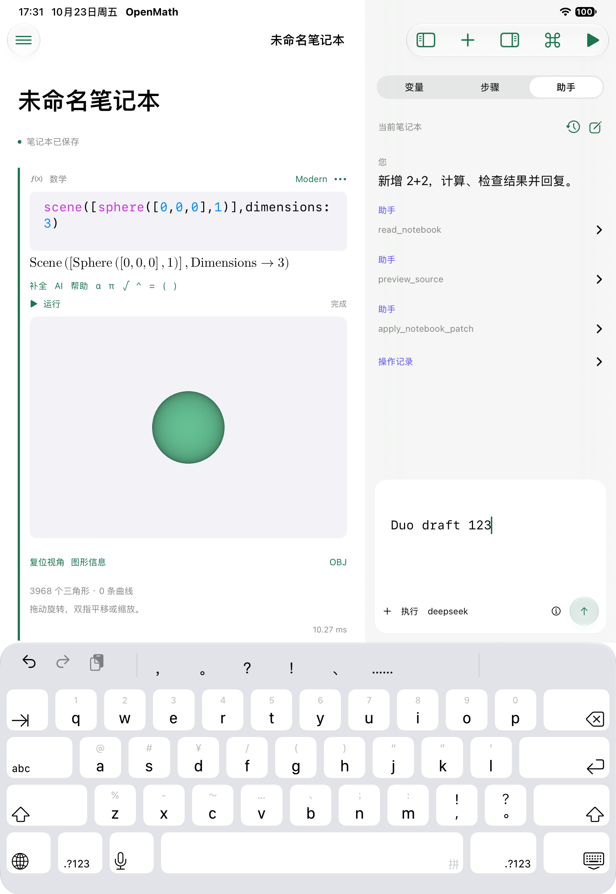

# iOS / iPadOS `.5` 运行记录

内容提交：`405a1f05d838bbd95d43e403871537a5888905c4`。Xcode 27.0 / SDK 与运行时 27.0，Rust 1.94.0，ARM64。原生实现经 [PR #7](https://github.com/He-RT/om-openmath/pull/7) 评审；公开补包仍待适用 CI、集成及来源记录。

用户在内容完成后明确允许验证，并要求通过 Device Hub 管理、同时最多存在一台模拟器（关机也计入）、一个型号完成后删除再创建下一个。实际顺序为 0 → iPhone → 0 → iPad → 0；没有修改系统权限、输入法或外观设置。模拟器的应用签名为 ad hoc，真机开发包未签名；未安装到物理设备。

| 设备 | 实际结果 | 原 53 条数学用例最大耗时 |
|---|---|---|
| iPhone 18 Pro / iOS 27.0 | 34 单元 + 6 UI，40 通过、0 失败、0 跳过 | 92.771 ms |
| iPad Pro 11-inch (M5) / iPadOS 27.0 | 34 单元 + 6 UI，40 通过、0 失败、0 跳过 | 622.252 ms |

单元与界面覆盖源码编辑/合成保护、文件保存回读/恢复、响应式计算、公式/Markdown、步骤、设置/Keychain、结构化表格、二维样本、参数探索、真实三维球体及横竖屏后的助手草稿。53 条的性能标准保持每条小于 1000 ms，未改阈值。[iPhone 数值与测试摘要](phone-results.json)、[iPad 数值与测试摘要](pad-results.json)来自实际 XCTest 结果，不代表真机性能。

新增移动助手回环使用本地 URLProtocol 合成响应，走真实 Pi → JavaScriptCore → Swift URLSession → Rust single-turn codec → 文稿工具六轮：读取、预览、修改、运行、检查结果 4、回复，再从操作记录撤销；检查 `.omnb` 文件确实保存并回读。没有访问真实供应商，未报告的 token 保持 null。iPad 安装应用的可执行文件和助手资源与本地候选 ZIP 逐字节一致。

## 失败及修复

- 原 `5c5c473e` 候选首轮：设置测试两项失败，来自模拟器应用只有 linker 签名、缺少 Xcode 应用签名信息。改为 ad hoc 签名后，设置两项及两设备最终完整轮次通过。
- 同轮数学 row 17 为 1264 ms，其中内核 FFI 127 ms、等待主线程恢复 1132 ms；原阈值下修复后的完整轮次通过，不隐藏首轮失败。
- 三维测试从相机内部拖动，随后点击了玻璃工具栏覆盖区域，误打开目录。补文稿底部留白、44pt 三维触点、稳定检查器标识；测试从文稿边缘滚动后，三维与助手草稿流程通过。旋转瞬间的中间截图未作为视觉完成依据。
- CI 中旧 Web 测试仍要求 iOS 返回三维占位；改为核对真实网格和 `z=x+y` 坐标。FFI 大 enum 经 Box 请求修复；`ctutils` 仅升级 0.4.2 → 0.4.4 修复 RUSTSEC-2026-0385，未忽略漏洞检查。
- 随后的 CI 生成一致性检查发现能力 DTO 的一行 TypeScript 注释未同步；实际 `export_bindings` 更新后重跑集成检查。修订不改变已测的 Swift/Rust 运行输入，不再创建模拟器。
- 工具快照的编码固定字段顺序，避免相同文稿的分页引用随机失效；取消后的消息只移除没有结果的调用，保留同一轮已完成配对。

原始失败根和成功 `.xcresult`、构建/打包日志保留在 `target/ios-pre-alpha.5/`；本目录只保留摘要、数值和选定截图。关键根为 `phone-5c5c473e.xcresult`、`phone-fixes-01.xcresult`、`phone-scene-gutter-02.xcresult`、`phone-mobile-loopback-02.xcresult`、`phone-405a1f05-final.xcresult`、`pad-405a1f05-final.xcresult`。发行资产的完整输入和散列使用独立移动清单记录，不覆盖旧 `.5` 清单。

## 未覆盖

没有真实模型、物理 iPhone/iPad、Apple Distribution/TestFlight/App Store、Duo 折叠硬件或 iOS 27.1 专用 API 验证。Duo 使用真实宽度自适应路径；本机没有对应模拟设备，不能把旋转测试等同于折叠验收。没有对本轮未修改的 Mac/Web 真实模型重新验收。
